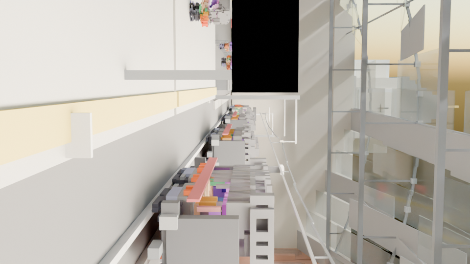
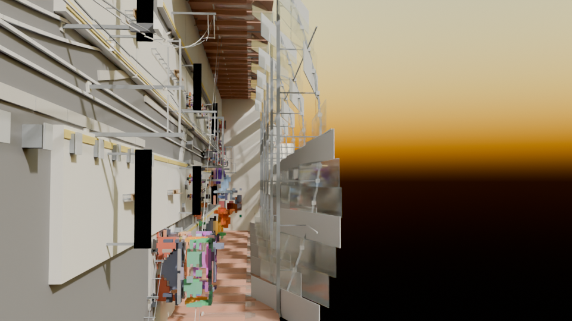
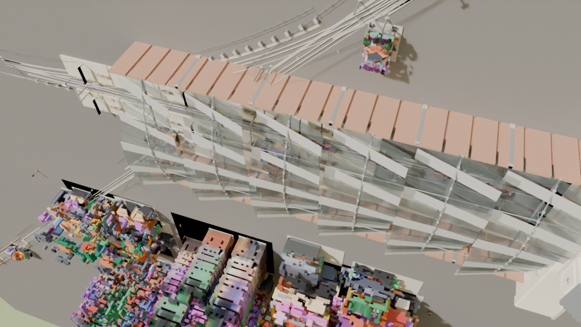
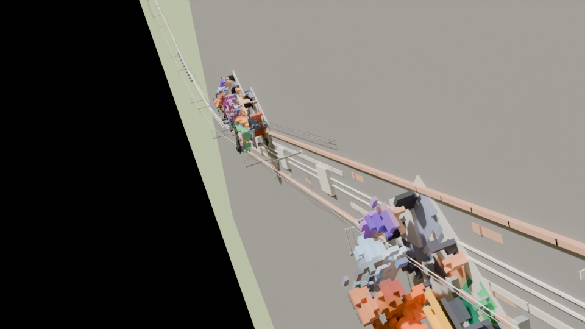
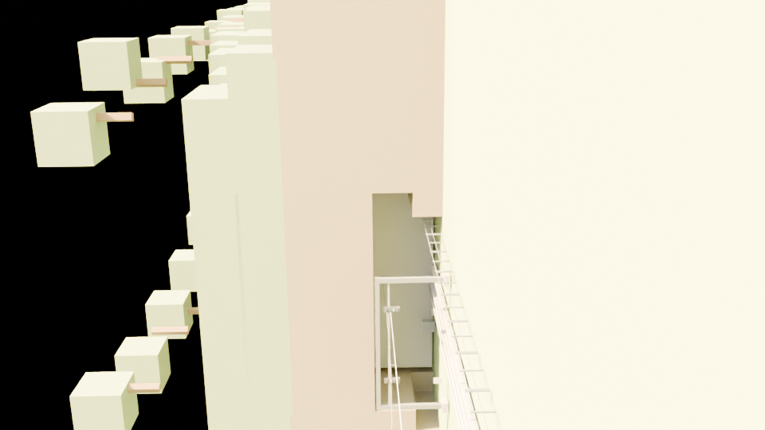
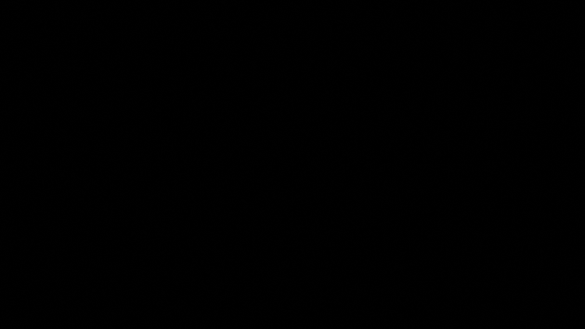
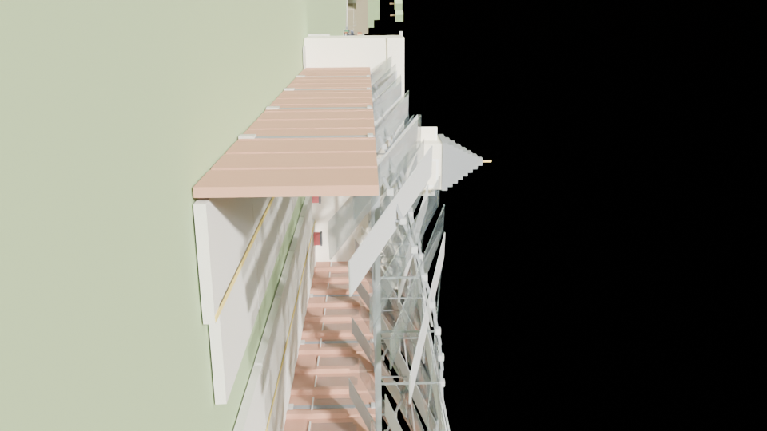

# roblox-project-99 — "Glanne Valley" railway

A complete, drivable Roblox railway built **entirely from code**, with every 3D model
sourced from open-source (CC0) packs.

Open **`place/RobloxProject99.rbxl`** in Roblox Studio and press Play: you spawn on the
concourse of Grand Central Terminus with a six-vehicle train waiting at Platform 1.
Press **E** to take control from the timetable computer and drive it.



---

## What's in the place

| | |
| --- | --- |
| Main line | 2,574 m of continuously aligned track (straights, S-bends, tunnel, terminus throats) |
| Termini | **Grand Central** (170 m trainshed, arc trusses, clock tower, colonnade) and **Harbour Terminus** (130 m) |
| Structures | masonry viaduct with arch rings over the River Glanne, 460 m tunnel with portals, hill shell, catenary masts + OLE wires, signal gantries, relay cabinets, boundary fencing |
| Stations | island platform with canopy, coping stones, tactile edge strips, name signs, benches, ticket machines, live departure boards |
| Trains | 11 CC0 train types converted to native parts; locos have spinning wheel sets (real `HingeConstraint` axles), head/tail lights, pantographs, buffers, gangways |
| Physics | longitudinal train dynamics: Davis resistance, grade + curve resistance, power-limited tractive effort, adhesion (with sand), air-brake build-up lag, jerk limiting |
| Driving | cab HUD with speedo, 8-notch power ladder, brake gauge, next-stop countdown, overspeed + emergency brake, doors, horn, direction; automatic timetable mode with real stopping curves |
| City | procedural street grid, skyscrapers/shopfronts/terraces from the CC0 building kits, street furniture, station crowds |
| Totals | **113,276 parts**, no Marketplace assets, no MeshIds — opens with zero missing-content warnings |

## Renders

All images in [`renders/`](renders/) are Cycles renders of **the actual place file**:
`tools/dump_parts.lua` exports every part (position, rotation basis, size, colour,
material class) straight out of the finished `.rbxl`, and `tools/render_place.py`
rebuilds that geometry in Blender. Nothing is a separate mock-up.

| | |
| --- | --- |
|  |  |
|  |  |
|  |  |

## Repo layout

```
place/RobloxProject99.rbxl     the built place — open this in Studio
renders/                       Cycles renders of the built place
3d-models/                     verbatim CC0 source packs (glb/fbx/obj + licence texts)
assets/vox/                    voxel blueprints: every CC0 model -> list of parts + colours
assets/provenance.json         per-asset audit trail (source file, tris, part count)
src/                           the generator (kit, track, station, scenery, city, rollingstock, world)
src/game/                      in-game Luau: TrainService, StationService, CabClient, TrainPhysics, TrackFollow, Config
tools/                         voxeliser, asset pipeline, part dumper, Blender renderer, build.sh
tests/                         headless luau unit tests (physics + alignment maths)
shots.json                     camera list used for the renders
```

## Rebuild it yourself

```bash
tools/build.sh          # voxelise -> build .rbxl -> dump parts -> render stills
cd tests && luau test_physics.luau && luau test_track.luau
```

Requirements: `rbxmk` (Roblox file format tool), Blender 4.5, Python 3 + numpy, the Luau CLI.

## How the CC0 models became parts

Roblox `.rbxl` files cannot carry mesh geometry — a `MeshPart` is only a pointer to an
uploaded cloud asset. So `tools/voxelize.py` runs each source `.glb` through Blender,
samples the pack's colour atlas at each triangle's UVs, voxelises the surface, smooths
colour across neighbours (so panels read as panels), then greedy-merges the voxels into
axis-aligned boxes. `src/kit.lua` stamps those boxes into the place. Train bodies get a
non-uniform scale so Kenney's toy proportions become a realistic loading gauge
(2.95 m wide, 4.10 m tall, 11 m long), and wheels are rebuilt as real cylinders.

## Licences

All models: **CC0 1.0** (Kenney — Train Kit, City Kits, Mini Characters). See
[`CREDITS.md`](CREDITS.md). All code in this repository is original work, MIT licensed.
